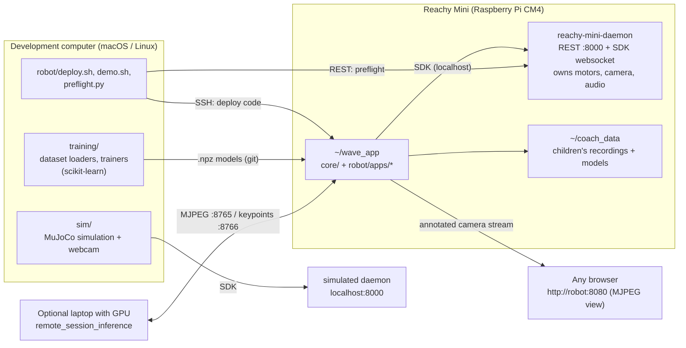
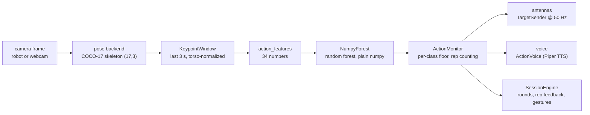
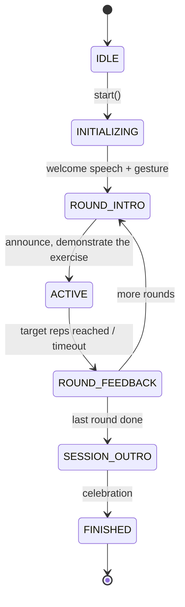
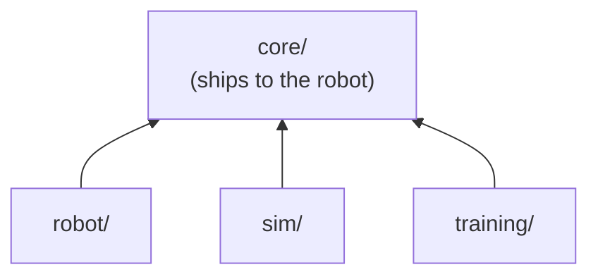

# Handover: Activity tracking with the Reachy Mini

**Minor Artificial Intelligence, Zuyd Hogeschool, 2026, blokperiode 1**
For: Research Centre for Data Intelligence, Maarten Vaessen (Researcher Data Intelligence)
Repository: `github.com/Gustavo-daCosta/ZM002-Activity-Tracking-Reachy-Mini`

This document is your starting point for working with the repository after we hand it over. It says what each
part of the project does, how the parts fit together, how to run them, and what you need to know before you
change anything. Each section links to the detailed document that covers it in more depth.

---

## Contents

1. [What you are receiving](#1-what-you-are-receiving)
2. [Status at handover: what works and what does not](#2-status-at-handover-what-works-and-what-does-not)
3. [Architecture summary](#3-architecture-summary)
4. [Repository map](#4-repository-map)
5. [Router configuration](#5-router-configuration)
6. [Setting up a development computer](#6-setting-up-a-development-computer)
7. [Connecting to the robot](#7-connecting-to-the-robot)
8. [Running the project](#8-running-the-project)
9. [Code examples: talking to the robot](#9-code-examples-talking-to-the-robot)
10. [Retraining the models](#10-retraining-the-models)
11. [Known limitations and pitfalls](#11-known-limitations-and-pitfalls)
12. [Data, privacy and licences](#12-data-privacy-and-licences)
13. [Suggested next steps](#13-suggested-next-steps)
14. [Where to read more](#14-where-to-read-more)

---

## 1. What you are receiving

| Item | Where |
|---|---|
| Source code (Python 3.12) | this repository |
| Trained recognition models (numpy `.npz` random forests) | `core/models/*.npz` (tracked in git) |
| Documentation | `README.md`, `docs/`, `walkthrough.md`, this file |
| Data-collection kit for volunteers | `collect/` |
| Research artefacts (GPU and pose-model experiments) | `repos/*.zip`, described in `repos/README.md` |
| Paper / abstract | `abstract/` (LaTeX source and `main.pdf`) |
| Instructions for AI coding agents (Claude Code, etc.) | `AGENTS.md`, `.claude/skills/` |
| The robot itself, already set up | Reachy Mini wireless, venvs and code installed (see section 7) |

The project goal was to find out **whether the Reachy Mini can detect a person and monitor their
activity**, as a first step toward a home exercise buddy for children with JDM who perform the CMAS
exercises. The answer is a working prototype. It runs entirely on the robot's CPU: it finds a person,
follows them with its head and body, recognizes what they are doing, and answers with antenna gestures and
speech.

---

## 2. Status at handover: what works and what does not

Please read this table before you show the robot to anyone. We have kept these numbers honest on purpose,
because people may trust a scoring system more than it deserves.

| Capability | Status | Notes |
|---|---|---|
| Person detection + skeleton (MoveNet int8 on the robot) | **Works** | ~34 ms/frame, about 9 FPS end to end; the camera is the bottleneck |
| Head + body following the person | **Works** | Reaches about ±75° of gaze; enable it with `--follow` |
| Wave recognition | **Works** | Field F1 is about **0.58** in a normal room. Do not quote the 0.918 dataset figure (section 11) |
| Clapping, jumping jacks | **Works** | — |
| Squat | **Works with a caveat** | Misses about 1 repetition in 7 with the legs in frame, and about 1 in 3 when the camera only sees the person from the waist up |
| Push-ups | **Not demonstrable** | Never measured, so we cannot say whether it works; do not build a demo on it |
| Guided exercise session (speech + gestures + rep counting) | **Works** | `robot.apps.exercise_session` |
| CMAS items 12 (chair rise), 14 (pick-up), 7/8 (arms up, timed) | **Recognizes that the item was done** | It does **not** give a CMAS score. Arms-up timing uses a geometric rule, not a trained model |
| Coach: the robot records a child, trains a model on its own CPU, then runs a workout | **Works** | About 4.5 min of recording; exercises: squat, arm raise, side bend |
| Remote mode: pose estimation on a laptop GPU, everything else on the robot | **Works** | Optional; for when you need more FPS |
| BlazePose / MediaPipe on the robot | **Impossible** | The CPU has no AES instructions, which the mediapipe binaries require. Laptop only |
| Camera focus | **Hardware fault** | The dw9807 focus motor on this unit fails over I2C, so the picture is blurry. Do not try to fix it in software |

Measurements and the reasoning behind each number are in [docs/action-recognition.md](docs/action-recognition.md).

---

## 3. Architecture summary

### 3.1 Where things run

The hardware decides most of the architecture. The robot is a Raspberry Pi CM4 with 2 GB of RAM and a
Cortex-A72 CPU, so it can only run some of the code a laptop can. For that reason the top-level folders are
split by **execution environment**.



- **Daemon** (`reachy-mini-daemon`, from Pollen Robotics, version 1.10.0): the only process that talks to
  the motors, the camera and the speaker. It serves a REST API on port 8000 (Swagger at `/docs`) and the
  websocket that the Python SDK `reachy_mini` uses. The simulation runs **the same daemon** with `--sim`, so
  code that works against the simulation also works against the robot.
- **Our apps** run as normal Python processes, either on the robot (fast, no network in the loop) or on a
  computer (handy for debugging; video arrives over WebRTC).

### 3.2 The recognition pipeline

The same pipeline is used in the simulation, on the robot and in training:



1. **Pose** (`core/pose_backends/`): turns a frame into 17 COCO keypoints (x, y in 0..1, plus a score).
   The robot uses MoveNet Lightning int8 through LiteRT. The laptop can also run BlazePose or ViTPose-S.
2. **Window** (`core/motion/window.py`): keeps the last 3 s of skeletons and normalizes each frame to the
   person's torso, so distance to the camera does not matter.
3. **Features** (`core/motion/features.py`): 34 hand-designed features, such as joint angles, oscillation
   of shoulders and hips, and wrist height. Training and inference call **the same functions**.
4. **Classifier** (`core/motion/forest.py`): a scikit-learn random forest exported to flat numpy arrays.
   The robot evaluates it without scikit-learn.
5. **Monitor** (`core/motion/actions.py`): picks the class, applies a per-class confidence floor (below it
   the answer is `none`), counts repetitions, and triggers the matching antenna gesture and spoken label.
6. **Session** (`core/session/`): an optional state machine on top that runs a guided workout.

### 3.3 The guided session state machine



The camera loop calls `SessionEngine.update()` on every frame and never blocks. Speech, gestures and
pauses all run on a separate transition thread (`core/session/engine.py`). Head following stops while a
gesture is playing, so the two never fight over the head (`core/coach/head.py`, `GestureMini`).

### 3.4 Dependency rule



`core/` imports **nothing** from `robot/`, `sim/` or `training/`. Everything in `core/` is also shipped
to the Raspberry Pi, so keep this rule. If you find yourself wanting to import `training.*` (scikit-learn)
from `core/`, the code belongs somewhere else.

---

## 4. Repository map

```
core/          shared by the simulation AND the robot
  pose_backends/   MoveNet (onnx / int8 tflite), BlazePose, ViTPose behind one interface (create_backend)
  motion/          window, features, forest, wave + action monitors, antennas, CMAS rules, voice (TTS)
  session/         guided workout: plan/phrases (config), state machine (engine), gestures
  coach/           guided recording, on-device trainer subprocess, head/gesture arbitration
  models/          tracked .npz forests; pose weights and voices download on first run
  tracking.py      image error -> head/body angles (CenteringFollower)
  vision.py        cameras, model download, drawing, remote MJPEG source
  stream.py        MjpegServer: annotated camera view for a browser
  metrics.py       per-stage timings and FPS
robot/         needs the physical robot
  connect.py       ROBOT_IP, connect_robot() = preflight + SDK connection
  preflight.py     checks and fixes robot state (stdlib only)
  deploy.sh        sets up ~/wave_env and syncs code to ~/wave_app
  demo.sh          one-command wave demo
  remote_camera_server.py   camera stream + session on the robot for the remote-GPU mode
  apps/            runnable entry points (see section 8)
sim/           needs only a computer (MuJoCo + webcam)
training/      recording, dataset loaders, trainers (scikit-learn)
collect/       standalone kit for volunteers to record exercises (sent as a zip)
tools/         dataset download, SSH setup, REST API reference generator
requirements/  sim.txt, robot.txt, training.txt; every pin is explained in place
docs/          detailed documentation (section 14)
abstract/      the paper (LaTeX)
repos/         archived experiment repositories (GPU, BlazePose, benchmarking)
datasets/      1.8 GB public skeleton datasets, gitignored; see datasets/SOURCES.md
```

### The apps (`robot/apps/`)

| App | What it does | Run with |
|---|---|---|
| `antennas` | Wiggles the antennas; the smallest possible test | computer |
| `explore` | Tour of the SDK: head, body, look-at, recorded emotions | computer |
| `head_tracking` | The daemon's built-in face tracking, printed | computer |
| `look_at_click` | Click on the camera image and the robot looks there | computer |
| `wave_antennas` | Recognizes waves; the antennas wave back; optional following | robot (`~/wave_env`) |
| `action_recognition` | Six-class recognition (or `--cmas`), with antenna + voice answers | robot (`~/camera_env`) |
| `exercise_session` | Guided workout: rounds, rep counting, speech, gestures (or `--cmas`) | robot (`~/camera_env`) |
| `coach` | Records a child, trains a personal model on the robot, then runs a workout | robot (`~/camera_env`) |
| `remote_session_inference` | Laptop side of the remote-GPU mode: pose on GPU, posts keypoints | GPU laptop |
| `local_session_fps` | Session fully on the robot, for measuring FPS against the remote mode | robot (`~/camera_env`) |
| `head_tracking_video` | Face tracking with a video window | computer |

---

## 5. Router and network configuration

The dedicated router shipped with the robot is a **TP-Link TL-WR3002X (AX3000 Wi-Fi 6 Router)**. It provides a private, isolated local network for low-latency communication between the development computer and the Reachy Mini, avoiding enterprise client-isolation policies and firewall blocks.

### 5.1 Network credentials and defaults

| Property | Value |
|---|---|
| **Router model** | TP-Link TL-WR3002X (AX3000) |
| **SSID (Wi-Fi Name)** | `Reachy Mini` |
| **Wi-Fi Password** | `reachy*321` |
| **Router Admin Webpage** | `http://tplinkwifi.net` or `http://192.168.0.1` |
| **Current Robot IP** | `192.168.137.53` (or `reachy-mini.local` via mDNS) |

### 5.2 Operating scenarios and setup options

Depending on whether you are working in an institutional setting or at home, configure the network using one of the two methods below:

#### Scenario A: University or corporate networks (e.g., Eduroam, 802.1X, captive portals)
Enterprise and university networks like **Eduroam** enforce 802.1X/WPA-Enterprise authentication (username + password/certificates) and strict client-to-client isolation, which blocks direct peer-to-peer communication between devices. The Reachy Mini cannot authenticate directly against Eduroam.

To set up the robot in an Eduroam or corporate environment:
1. **Connect your computer to Eduroam** via Wi-Fi so that your computer retains normal internet access.
2. **Connect your computer to the router via Ethernet**:
   - Power on the TP-Link TL-WR3002X router.
   - Connect an Ethernet cable from your computer (using an Ethernet port or USB-C adapter) to the **WAN/LAN port** of the router.
3. **Configure the router in Access Point (AP) mode**:
   - Open a web browser on your computer and go to `http://tplinkwifi.net` (or the default router gateway address).
   - Follow the TP-Link setup wizard (or navigate to *Advanced $\rightarrow$ Operation Mode*) and select **Access Point mode**.
   - Confirm that the wireless network is broadcasting SSID `Reachy Mini` with password `reachy*321`.
4. **Share internet from the computer (optional but recommended)**:
   - If the robot needs outbound internet access (e.g., for `pip` packages or updates), enable internet connection sharing on your laptop:
     - **macOS:** *System Settings $\rightarrow$ General $\rightarrow$ Sharing $\rightarrow$ Internet Sharing* (share from Wi-Fi to Ethernet).
     - **Windows:** *Control Panel $\rightarrow$ Network and Sharing Center $\rightarrow$ Change adapter options $\rightarrow$ Wi-Fi Properties $\rightarrow$ Sharing tab $\rightarrow$ Allow other network users to connect through this computer's Internet connection*.
5. **Connect the robot**:
   - Turn on the Reachy Mini; it is already configured to connect automatically to the `Reachy Mini` Wi-Fi network.
   - Your computer communicates with the robot directly over the local subnet created by the router.

#### Scenario B: Home or residential networks (WPA2/WPA3-Personal)
On standard home Wi-Fi networks (which do not use enterprise authentication or client isolation), you have two options:

1. **Direct home Wi-Fi connection**:
   - You can connect both your development computer and the Reachy Mini directly to your home Wi-Fi. (To connect the robot to a new Wi-Fi, use an Ethernet cable or the Reachy Mini Control app on first boot).
2. **Using the TP-Link TL-WR3002X router** (recommended for a dedicated, stable environment):
   - **Access Point (AP) mode:** Connect the router's WAN port to your home modem/router with an Ethernet cable. The router broadcasts the `Reachy Mini` Wi-Fi network, giving all connected devices seamless internet and local communication.
   - **Range Extender / Repeater mode:** In the router admin interface (`http://tplinkwifi.net`), switch the operation mode to **Range Extender / Repeater mode**. The router connects wirelessly to your home Wi-Fi network and extends it while broadcasting the local subnet. Both the robot and your computer can connect to `Reachy Mini` without needing any physical Ethernet cables.

### 5.3 Important ports and IP reservation

The following ports on the Reachy Mini must be open and accessible across the local network:

| Port | Protocol | Purpose |
|---|---|---|
| `22` | TCP | SSH terminal access and code deployment (`robot/deploy.sh`) |
| `8000` | HTTP | Daemon REST API and interactive Swagger documentation (`/docs`) |
| `8080` / `8090` | HTTP | Live annotated MJPEG camera stream and session visual overlay (`stream.py`) |
| `8765` / `8766` | WebSockets / HTTP | Remote-GPU session camera feed and keypoint streaming |

> [!TIP]
> **DHCP Address Reservation (Static IP):**
> To prevent the robot's IP address from changing across reboots, log into the router admin interface at `http://tplinkwifi.net`, go to *Advanced $\rightarrow$ Network $\rightarrow$ DHCP Server $\rightarrow$ Address Reservation*, and bind the Reachy Mini's MAC address to a fixed IP (such as `192.168.137.53`).
> If the robot's IP ever changes, update `ROBOT_IP` in [`robot/connect.py`](file:///home/guti/Documents/zuyd/ZM002-Activity-Tracking-Reachy-Mini/robot/connect.py) and `HostName` under `Host reachy` in `~/.ssh/config`.

---

## 6. Setting up a development computer

Tested on macOS (Apple Silicon). Linux works the same way, except that `sim/start.sh` uses `python`
instead of `mjpython`.

```bash
git clone git@github.com:Gustavo-daCosta/ZM002-Activity-Tracking-Reachy-Mini.git
cd ZM002-Activity-Tracking-Reachy-Mini

python3.12 -m venv reachy_mini_env
reachy_mini_env/bin/python -m pip install "reachy_mini==1.10.0"          # must equal the daemon version
reachy_mini_env/bin/python -m pip install -r requirements/sim.txt        # MuJoCo, mediapipe, TTS
reachy_mini_env/bin/python -m pip install -r requirements/training.txt   # only if you retrain models
```

- Always use `reachy_mini_env/bin/python`, not the system Python.
- Keep the SDK version **equal** to the daemon on the robot (`1.10.0`). A mismatch shows a warning and can
  break things. If you update one, update both.
- On macOS, give your terminal camera access (System Settings → Privacy & Security → Camera).
- Pose weights (`.onnx`, `.tflite`, `.task`) and Piper voices download automatically on first use.

---

## 7. Connecting to the robot

### Network

- The robot and your computer **must be on the same network** (section 5).
- Current address: `192.168.137.53`. It comes from DHCP and **may change**; older documents mention
  `10.42.0.66` and `192.168.137.171`. You can also reach the robot as `reachy-mini.local` (mDNS).
- The address is set in only two places: `ROBOT_IP` in `robot/connect.py`, and `HostName` under `Host reachy`
  in `~/.ssh/config`. To override it for one run, set `REACHY_HOST=<ip>`.
- A **dead battery looks exactly like a network failure**. Plug in the power cable before you debug the
  network.

### SSH

```bash
tools/reachy_ssh_setup.sh                   # once: creates the key and the "reachy" alias
ssh reachy 'echo ok'                        # user pollen; password fallback: root
```

### What is installed on the robot

| Path | Purpose |
|---|---|
| `/venvs/*` | Pollen's daemon and apps venvs. **Never modify them** |
| `~/wave_app/` | Our code (`core/`, `robot/`, `training/`), synced by `robot/deploy.sh` |
| `~/wave_env/` | Python 3.12 venv made by `deploy.sh`: LiteRT, onnxruntime, OpenCV, Piper, scikit-learn, `reachy_mini` |
| `~/camera_env/` | Python 3.13 venv with system site-packages, needed for **Picamera2** (only importable from the system Python). It runs the apps that read the camera directly. It is **not** created by `deploy.sh`, so keep it |
| `~/coach_data/` | Children's recordings (keypoints only) and their personal models |

### Preflight: always run it first

Every time the robot boots or its daemon restarts, it is **asleep with the motors disabled**. Before anything
that moves the robot or uses the camera, run:

```bash
reachy_mini_env/bin/python robot/preflight.py --fix --need media
```

It checks, in order: network → daemon → backend → running apps → motors → awake → camera → tracker. With
`--fix` it enables the motors, wakes the robot up and takes the camera back.

| Exit code | Meaning |
|---|---|
| 0 | Ready |
| 1 | Not ready: read the ✖ line, which names the problem |
| 2 | Unreachable: check network and power before anything else |

Python scripts that use `robot.connect.connect_robot()` run this preflight automatically.

### Useful commands

```bash
curl -s http://192.168.137.53:8000/api/daemon/status                  # daemon over REST
open http://192.168.137.53:8000/docs                                  # Swagger UI
ssh reachy 'journalctl -u reachy-mini-daemon -n 100 --no-pager'      # daemon logs
```

The robot's clock is not synchronized with NTP, so do not trust the timestamps in the journal.

---

## 8. Running the project

### 8.1 No robot: the simulation

```bash
./sim/start.sh                                                    # terminal 1: MuJoCo + daemon on localhost:8000
reachy_mini_env/bin/python -m sim.body_tracking --detect-actions  # terminal 2: webcam drives the robot
reachy_mini_env/bin/python -m sim.exercise_session                # guided workout with your webcam
reachy_mini_env/bin/python -m sim.coach --name Test               # coach flow
```

The webcam is picked **by name** (`--camera FaceTime`). OpenCV indices change when, for example, an iPhone
connects as a camera. To see the names: `python -m sim.camera_check --list`. More in
[docs/simulation.md](docs/simulation.md).

### 8.2 With the robot

First deploy the code. Run it once in full; after that only the code changes:

```bash
robot/deploy.sh               # first time: venv + pip + code (the robot needs internet)
robot/deploy.sh --code-only   # after any code or model change (takes seconds)
```

Then pick a demo:

```bash
# One-command wave demo: ping, sync, preflight, run. View at http://<robot>:8080/
./robot/demo.sh

# Six-class action recognition, robot follows the person
ssh -t reachy 'cd ~/wave_app && ~/camera_env/bin/python -m robot.apps.action_recognition --follow --stream-port 8080'

# Guided exercise session (squat, clapping, jumping jacks, wave)
ssh -t reachy 'cd ~/wave_app && ~/camera_env/bin/python -m robot.apps.exercise_session --reps-per-round 2 --stream-port 8080'

# CMAS session: chair rise, pick-up, arms up (timed)
ssh -t reachy 'cd ~/wave_app && ~/camera_env/bin/python -m robot.apps.exercise_session --cmas --stream-port 8090'

# Coach: learns a child's exercises on the robot, then plays a workout
ssh -t reachy 'cd ~/wave_app && ~/camera_env/bin/python -m robot.apps.coach --name Ana \
    --stream-port 8080 --train-python ~/wave_env/bin/python'
```

- Use `ssh -t` so that Ctrl+C reaches the app. The apps park the robot and put it to sleep when they exit.
- Open `http://<robot>:<stream-port>/` in any browser to see the annotated camera view. It needs about 10 s
  to appear.
- The camera must see the **whole person**. If needed, place the robot at the edge of the table.
- Common options: `--follow` (head and body follow the person; off by default in the apps, on in
  `demo.sh`), `--stream-port N`, `--seconds N`, `--no-sleep`, `--help`.

Step-by-step guides with troubleshooting: [docs/demo.md](docs/demo.md) (wave),
[docs/cmas-demo.md](docs/cmas-demo.md) (CMAS), [docs/robot.md](docs/robot.md) (coach, remote GPU mode).

### 8.3 Remote GPU mode (optional)

The robot streams its camera and runs the session. A laptop with a GPU runs the pose model and posts the
keypoints back:

```bash
# on the robot
ssh -t reachy 'cd ~/wave_app && ~/camera_env/bin/python -m robot.remote_camera_server \
    --host localhost --width 192 --height 108 --session --follow'

# on the GPU laptop
reachy_mini_env/bin/python -m robot.apps.remote_session_inference --model movenet-lightning \
    --remote-camera http://<robot>:8765/stream.mjpg --result-url http://<robot>:8766/result --width 192 --window
```

`curl http://<robot>:8766/status` shows the active model and its live predictions. To use a coach-trained
model, add `--activity-model ~/coach_data/models/<name>.npz --rounds squat,arm_raise,side_bend`. Details are in
[docs/robot.md](docs/robot.md#remote-gpu-pose-inference-with-personalized-activity-recognition).

### 8.4 Leave the robot safe

When you finish, put the robot to sleep if you woke it, stop any head tracking you started, and do not leave
the camera released. Our apps do all of this on exit. If a script crashed:

```bash
curl -s -X POST http://192.168.137.53:8000/api/move/play/goto_sleep
```

---

## 9. Code examples: talking to the robot

Run these from the repository root, with `reachy_mini_env/bin/python <file>.py` or as `python -m`. They
connect over the network and run the preflight first through `connect_robot()`. To try them **without the
robot**, start `sim/start.sh` and set `REACHY_HOST=localhost`. Note that the simulation has no camera or
audio, so use `media=False` there.

### 9.1 Move the head and body

```python
import numpy as np
from reachy_mini.utils import create_head_pose
from robot.connect import connect_robot

with connect_robot(media=False, sleep_on_exit=True) as mini:
    mini.goto_target(head=create_head_pose(pitch=-15, yaw=20), duration=1.0)  # degrees; blocks for `duration`
    mini.goto_target(head=create_head_pose(roll=15), duration=1.0)
    mini.goto_target(body_yaw=np.deg2rad(30), duration=1.0)                  # body yaw is in radians
    mini.look_at_world(0.5, 0.2, 0.1, duration=1.0)                          # a point in metres: x fwd, y left, z up
    mini.goto_target(head=create_head_pose(), body_yaw=0.0, duration=1.0)    # back to neutral
```

Limits: pitch and roll ±40°, head yaw at most ±60° from the body, z from −4 to +2.5 cm. Outside them the
daemon reports `IK error: ... not achievable`. `goto_target` resets the body yaw to 0 unless you pass
`body_yaw=None`.

### 9.2 Antennas

Antenna values are `[right, left]` in **radians**, from the robot's point of view: index 0 is on *your*
left when you face the robot.

```python
import time
from core.motion.antennas import AntennaWave, TargetSender, antennas_with_neutral
from robot.connect import connect_robot

with connect_robot(media=False, sleep_on_exit=True) as mini:
    # One-off poses: goto_target blocks until the pose is reached.
    mini.goto_target(antennas=[0.6, -0.6], duration=0.5)
    mini.goto_target(antennas=[-0.6, 0.6], duration=0.5)

    # Smooth reactive motion: a 50 Hz thread calls set_target (non-blocking) with whatever the callable returns.
    wave = AntennaWave(amplitude_deg=30, freq_hz=2.0, duration_s=1.5)
    sender = TargetSender(mini, lambda now: antennas_with_neutral(wave.angles(now))).start()
    try:
        for _ in range(3):
            wave.trigger(time.perf_counter())
            time.sleep(2.5)
    finally:
        sender.stop()
```

For reactive control, use `set_target` in a loop (or `TargetSender`). `goto_target` blocks for its whole
`duration`, which makes it unsuitable for a vision loop.

### 9.3 Camera

**From a computer** (frames arrive over WebRTC):

```python
import time
import cv2
from robot.connect import connect_robot

with connect_robot(media=True) as mini:
    deadline = time.monotonic() + 10
    frame = None
    while frame is None and time.monotonic() < deadline:
        frame = mini.media.get_frame()          # BGR numpy array, read-only
        time.sleep(0.05)
    if frame is None:
        raise SystemExit("no camera frames: check `curl <robot>:8000/api/media/status`")
    frame = frame.copy()                        # copy before drawing on it
    cv2.imwrite("snapshot.png", frame)
    print("saved", frame.shape)
```

**On the robot** (faster; run with `~/camera_env/bin/python`, which is the only venv that has Picamera2):

```python
from robot.apps.common import Picamera2Source

camera = Picamera2Source(width=640, height=360)
try:
    frame = camera.read()                       # BGR numpy array or None
    print(frame.shape if frame is not None else "no frame")
finally:
    camera.close()
```

To watch what the robot sees from a browser, push frames to `core.stream.MjpegServer(port=8080).start()`
with `server.update(frame)`, then open `http://<robot>:8080/`.

### 9.4 Feedback: recognize an action and react

This is the full loop in a few lines: pose, then classifier, then antennas and voice. Here it runs on a
computer with the robot's camera, so performance is lower than with the on-robot apps.

```python
import time
from core.motion.actions import ActionMonitor
from core.pose_backends import create_backend
from core.motion.antennas import TargetSender
from robot.connect import connect_robot

with connect_robot(media=True, sleep_on_exit=True) as mini:
    pose = create_backend("movenet-lightning")    # "movenet-tflite" on the robot
    monitor, sender = None, None
    try:
        end = time.perf_counter() + 60
        while time.perf_counter() < end:
            frame = mini.media.get_frame()
            if frame is None:
                time.sleep(0.01)
                continue
            if monitor is None:
                h, w = frame.shape[:2]
                monitor = ActionMonitor(w / h)    # REAL camera aspect ratio, never a constant
                sender = TargetSender(mini, monitor.antennas).start()   # antennas answer detections
            now = time.perf_counter()
            monitor.update(now, pose.infer(frame).keypoints)           # also speaks the action name
            d = monitor.detection
            if d is not None and d.is_action:
                print(f"{d.action} {d.score:.2f}  counts={monitor.counts}")
    finally:
        if sender:
            sender.stop()
        pose.close()
```

- `ActionMonitor(aspect_ratio, model_path=..., voice=...)`. Pass `model_path="core/models/cmas_classifier.npz"`
  for the CMAS items, or `~/coach_data/models/<name>.npz` for a coach model. Pass `voice=None` for silence.
- `monitor.set_target_action("squat", callback)` only counts the target exercise and calls
  `callback(action, reps, now)` on each repetition. `SessionEngine` is built on this.
- To use a gesture together with speech, call
  `core.session.gestures.play_gesture_with_speech(mini, WELCOME_GESTURE, voice, "Hello!")`.

### 9.5 Voice

`ActionVoice` (`core/motion/voice.py`) is offline neural TTS (Piper). It plays sound **on the machine
where it runs**: on the robot that is the robot's speaker, on your computer it is your computer's speaker.
It falls back to `spd-say`, and then to silence.

```python
from core.motion.voice import ActionVoice

voice = ActionVoice(voice_model="en_US-lessac-medium")  # downloads the voice on first use (needs internet)
voice.speak("Hi! I am Reachy. Shall we exercise together?", non_blocking=False)
voice.speak("Great job!")                               # queued; returns immediately
voice.wait()                                            # wait until everything queued has been said
voice.close()
```

Other voices: `pt_BR-faber-medium`, `en_GB-alba-medium`, or any Piper voice name (see `KNOWN_VOICE_PATHS`).
The children's phrases are in `core/session/config.py` and `core/coach/phrases.py`.

To play sound on the **robot's** speaker from a computer, and to set its volume:

```python
from robot.connect import connect_robot

with connect_robot(media=True) as mini:
    mini.media.play_sound("count.wav")   # built-in: wake_up, go_sleep, count, dance1, confused1, impatient1 (.wav)
```

```bash
curl -s -X POST http://192.168.137.53:8000/api/volume/set -H 'Content-Type: application/json' -d '{"volume": 70}'
```

### 9.6 Without Python: the REST API

```bash
H=http://192.168.137.53:8000
curl -s $H/api/daemon/status
curl -s -X POST $H/api/move/play/wake_up
curl -s -X POST $H/api/move/goto -H 'Content-Type: application/json' \
     -d '{"antennas": [0.5, -0.5], "duration": 1.0}'
curl -s -X POST $H/api/move/play/goto_sleep
```

Every endpoint, with schemas and examples, is listed in `.claude/skills/reachy-api/endpoints.md`. The SDK
reference is in `.claude/skills/reachy-sdk/`.

---

## 10. Retraining the models

| Model | File | Trained by | Data |
|---|---|---|---|
| Six actions | `core/models/action_classifier.npz` | `training/train_actions.py` | NTU RGB+D 60, UCF101 (HMDB51 only for testing) |
| Wave | `core/models/wave_classifier_ntu.npz` | `training/train_wave.py` | NTU RGB+D 60 |
| CMAS items | `core/models/cmas_classifier.npz` | `training/train_cmas.py` | NTU RGB+D 60 |
| Squat / arm raise / side bend | `core/models/exercise_classifier.npz` | `training/train_exercises.py` | Group recordings made with `collect/` |
| Per child (coach) | `~/coach_data/models/<name>.npz` | the coach on the robot | That child's recording + the group's |

```bash
tools/download_datasets.sh                                 # 1.8 GB of skeleton pickles into datasets/
reachy_mini_env/bin/python -m training.train_actions --ntu datasets/ntu60_hrnet.pkl \
    --ucf datasets/ucf101_hrnet.pkl --hmdb datasets/hmdb51_2d.pkl --crop-fraction 0.25
robot/deploy.sh --code-only                                # ship the new .npz to the robot
```

Evaluation is grouped **by person** (`GroupKFold`): nobody appears in both training and test data. This
makes the scores lower, but they reflect what you will see in practice. To add a new exercise, record it
with `collect/record_exercises.py` (with several people, two sessions each) and retrain with
`train_exercises`. The full recipe is in [docs/training.md](docs/training.md).

There is **no unit-test suite**, by decision. We verify changes end to end instead: replay
`training/data/wave/*.npz` through the monitors, run the simulation with a webcam, or run the app on the
robot.

---

## 11. Known limitations and pitfalls

**About the results**
- The `wave` F1 of 0.918 (and clapping 0.898) on the dataset is inflated, because the training videos all
  come from one studio setting. For a robot in a normal room, quote **0.581** for wave.
- The training data covers adults from public datasets. Nothing has been validated on children or on JDM
  patients.
- The CMAS mode recognizes that an item **was performed**. It does not score it. Sitting down can count as a
  chair rise, and fast repeated sit-stands are not recognized.

**About the robot**
- After every boot the robot is asleep with the motors off, so run the preflight (section 7).
- If one client opens the SDK with `media_backend="no_media"`, the daemon's camera is released and other
  apps get no frames. `connect_robot(media=False)` takes it back automatically.
- SDK frames are read-only, so call `.copy()` before you draw on them.
- Over WebRTC, `get_frame_jpeg()` returns nothing and `get_DoA()` returns `None`. Use `GET /api/state/doa`
  instead.
- Gravity compensation does not work, because it needs the Placo kinematics engine and the robot runs
  AnalyticalKinematics.
- Battery level cannot be read. A robot that stops answering in the middle of a task is usually out of power.
- Over SSH, `pkill -f <app>` also kills your own SSH session. Use `pgrep -af "[r]obot.apps.<app>"` and kill by
  PID.
- Harmless messages on macOS: the GStreamer `libgstpython` warning, `No Reachy Mini Audio USB device found!`,
  and "Audio system is not initialized".

**Ask before you do these**, because they change the robot's state: restarting the daemon, rebooting,
installing/removing Pollen apps, `pip install` on the robot, Wi-Fi endpoints (`POST /wifi/*`),
`/update/*`, and changing the kinematics engine.

---

## 12. Data, privacy and licences

- **Children's data**: the coach saves **keypoints only, never video**, in `~/coach_data/` on the robot. To
  delete a child's data:
  `ssh reachy 'rm -r ~/coach_data/recordings/<name> ~/coach_data/models/<name>.*'`.
- In the simulation, coach recordings go to `collect/coach_recordings/<name>/` and models go to
  `core/models/users/`. Both are gitignored.
- **Datasets**: NTU RGB+D requires accepting the ROSE Lab terms, and UCF101 / HMDB51 are research-use only.
  Provenance and checksums are in `datasets/SOURCES.md`. The `.npz` models are derived from this data, so the
  same restrictions apply to any commercial use.
- **Code**: MIT licence (`LICENSE`).

---

## 13. Suggested next steps

1. **Validate on the target group**: record children (with consent) doing the real CMAS items, and measure
   the recognizers on that data. This is the most important open question.
2. **Move from "performed" to "scored"**: CMAS needs grades, not detection. The keypoint windows and
   features are the place to start; arms-up timing (items 7/8) already measures a duration.
3. **Fix or replace the camera focus module** (hardware). A sharper image should help keypoint quality.
4. **Measure push-ups**, or remove them from the class list.
5. **Make the network setup permanent** (section 5) so the robot's IP no longer changes.
6. **Provision `~/camera_env` with a script** so a fresh robot can be set up from `deploy.sh` alone.

---

## 14. Where to read more

| Document | Covers |
|---|---|
| [README.md](README.md) | Why the project exists, the client's context (JDM, CMAS) |
| [docs/overview.md](docs/overview.md) | Technical overview and quickstart |
| [walkthrough.md](walkthrough.md) | Code walkthrough, file by file, including the SSH command guide |
| [docs/simulation.md](docs/simulation.md) | MuJoCo simulation and webcam |
| [docs/robot.md](docs/robot.md) | Deployment, package constraints on aarch64, coach, remote GPU mode |
| [docs/demo.md](docs/demo.md) / [docs/cmas-demo.md](docs/cmas-demo.md) | Demo scripts and how they fail |
| [docs/action-recognition.md](docs/action-recognition.md) | Recognition results per class, with caveats |
| [docs/training.md](docs/training.md) | How the models are trained, step by step |
| [docs/pose-models.md](docs/pose-models.md) | The four pose backends and their measured cost |
| [AGENTS.md](AGENTS.md) | Operating manual for AI coding agents (also a good checklist for people) |
| [repos/README.md](repos/README.md) | The archived GPU and pose-model experiments |
| [Pollen Robotics docs](https://huggingface.co/docs/reachy_mini) | Official Reachy Mini SDK and hardware documentation |
